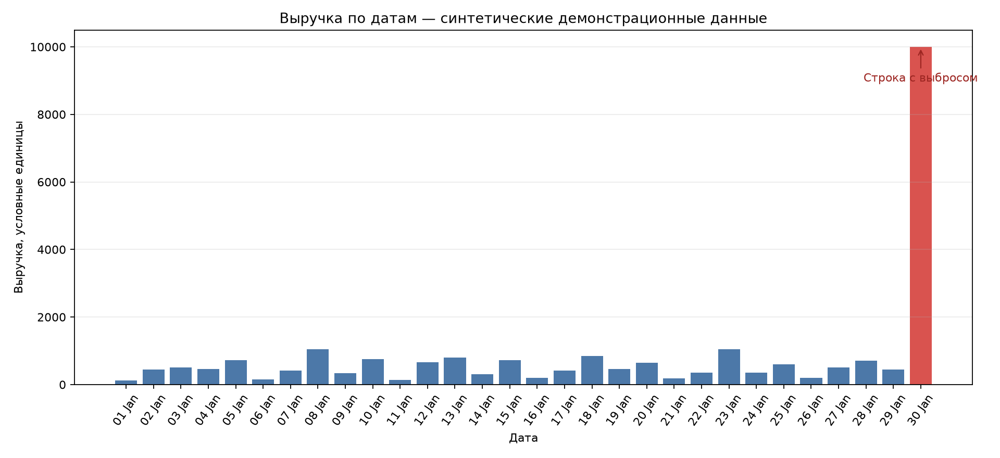

# День 3 — исследование данных и поиск аномалий

> **Важно:** это воспроизводимый учебный набор синтетических данных, а не реальные продажи. Одно экстремальное значение цены намеренно добавлено, чтобы показать влияние выброса.

## Качество данных

- Источник: `synthetic demonstration data`.
- Строк в таблице `sales`: 30.
- Целостность SQLite (`PRAGMA integrity_check`): `ok`.
- Строк с пропусками в обязательных полях: 0.
- Повторных идентификаторов: 0.
- Повторных записей (дата, товар, количество, цена): 0.
- Проверки ограничений схемы: положительное количество и цена, непустое название товара, корректная дата.

## Статистика и выбросы

Цены указаны в условных единицах, поскольку валюта в учебных данных не задана.

| Показатель | Все записи | Без выявленных выбросов |
|---|---:|---:|
| Количество продаж | 30 | 29 |
| Средняя цена | 498.97 | 171.38 |
| Медианная цена | 170.00 | 170.00 |
| Выручка | 24,569.00 | 14,570.00 |

Для выявления выбросов применён метод межквартильного размаха: `IQR = Q3 − Q1`; границы — `Q1 − 1.5 × IQR` и `Q3 + 1.5 × IQR`. Полученные значения: `Q1 = 150.00`, `Q3 = 200.00`, нижняя граница `75.00`, верхняя граница `275.00`. Выбросы по цене: продажа №30 от 2026-01-30: 9 999.00.

### Почему необычные значения искажают анализ

Среднее арифметическое использует величину каждого наблюдения, поэтому одна очень высокая цена заметно поднимает среднюю цену. Если такая продажа включена в дневную выручку, она также увеличивает сумму и визуально создаёт пик на графике. Медиана зависит от порядка значений, а не от размера крайних значений, поэтому обычно устойчивее. Удалять необычную запись автоматически нельзя: сначала следует выяснить, является ли она ошибкой ввода или реальной редкой продажей. Здесь значение намеренно синтетическое и сохраняется в базе для демонстрации; сравнение без него приведено отдельно.

## Выручка по датам

Красным отмечен день с продажей, цена которой признана выбросом методом IQR.

## Выводы

1. В базе 30 строк; проверка целостности SQLite: `ok`, пропусков: 0, повторных ID: 0, повторных записей: 0. Проверки качества пройдены.
2. Средняя цена равна 498.97, медиана — 170.00 условных единиц. Разница показывает, что распределение цен чувствительно к крайнему значению.
3. Метод IQR выделил 1 выброс(а): продажа №30 от 2026-01-30: 9 999.00. Верхняя граница без выбросов — 275.00.
4. После исключения отмеченных выбросов средняя цена составляет 171.38, медиана — 170.00. Среднее с выбросом выше базового среднего на 191.1%.
5. Суммарная выручка с выбросом — 24,569.00; без него — 14,570.00. Выброс формирует 40.7% выручки в этом демонстрационном наборе.
6. Максимальная дневная выручка зафиксирована 2026-01-30: 9,999.00; минимальная — 2026-01-01: 120.00. Пик совпадает с датой искусственно добавленного выброса.
